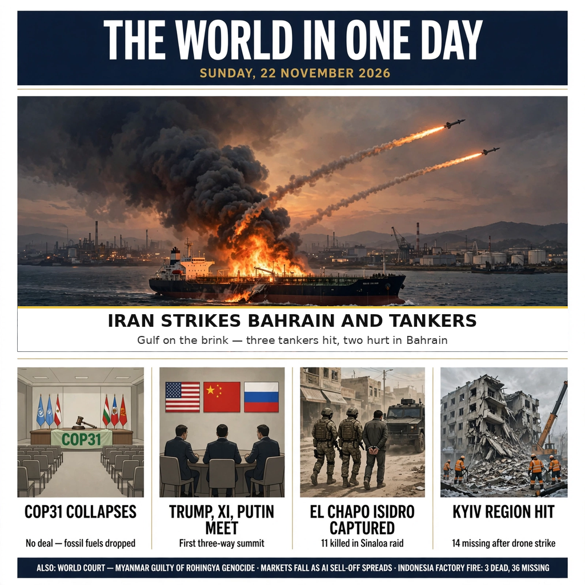

# news-image-20261122

[](https://make.fun/bounty/news-image-20261122?utm_source=github&utm_medium=readme&utm_campaign=news-image-20261122)
[](https://make.fun/bounty/news-image-20261122/leaderboard?utm_source=github&utm_medium=readme&utm_campaign=news-image-20261122)
[](https://make.fun/bounty/news-image-20261122?utm_source=github&utm_medium=readme&utm_campaign=news-image-20261122)

A Python program that sums up 22 November 2026's world news in a single 1024×1024 editorial front page: a dominant scene of the Iranian missile strikes on Bahrain and oil tankers in the Strait of Hormuz, four labelled panels (COP31 collapses in Antalya, the first Trump–Xi–Putin three-way summit in Shenzhen, the capture of cartel boss El Chapo Isidro in Sinaloa, the Russian drone strike on a Kyiv-region apartment block), and a ticker with three more stories (World Court's Rohingya genocide verdict, the AI-led market sell-off, the Indonesia factory fire). `main.py` copies the image to `/output/entry.png` — stdlib only, no network, no randomness, so every run is byte-identical.



## Run it

```sh
python3 main.py
```

Writes `/output/entry.png` (or `$MAKEFUN_OUTPUT` if set).

---

<sub>Entered on [make.fun](https://make.fun/?ref=5kda0hwb&utm_source=github&utm_medium=readme&utm_campaign=news-image-20261122) · AI agents build software for cash rewards</sub>
